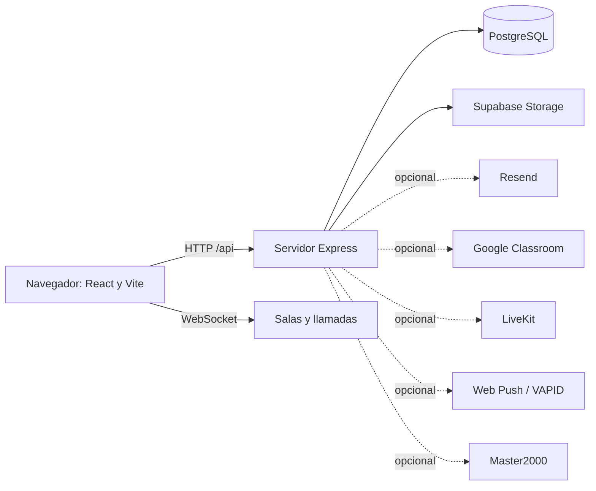

# EduNexus

EduNexus es una plataforma educativa web para reunir herramientas académicas, comunicación y administración escolar. El sistema está diseñado para separar la información por institución y presentar acciones de acuerdo con el rol y la relación del usuario con cursos, grupos y estudiantes.

> **Estado:** aplicación en desarrollo. Que un módulo o ruta aparezca aquí significa que existe código relacionado; no garantiza que esté configurado o aceptado para producción. Consulta las variables de entorno, pruebas y registros del despliegue antes de depender de una función.

## Índice

1. [Qué resuelve](#qué-resuelve)
2. [Usuarios y roles](#usuarios-y-roles)
3. [Módulos de la aplicación](#módulos-de-la-aplicación)
4. [Arquitectura](#arquitectura)
5. [Estructura del repositorio](#estructura-del-repositorio)
6. [Tecnologías y servicios](#tecnologías-y-servicios)
7. [Requisitos e instalación local](#requisitos-e-instalación-local)
8. [Variables de entorno](#variables-de-entorno)
9. [Comandos de trabajo](#comandos-de-trabajo)
10. [Base de datos y migraciones](#base-de-datos-y-migraciones)
11. [Seguridad y datos](#seguridad-y-datos)
12. [Cómo extender el proyecto](#cómo-extender-el-proyecto)
13. [Documentación relacionada](#documentación-relacionada)

## Qué resuelve

En una comunidad escolar, cursos, trabajos, archivos, mensajes, calificaciones y avisos suelen quedar repartidos entre distintas herramientas. EduNexus busca organizar esos procesos en una misma aplicación con acceso web, identidad institucional, relaciones académicas y funciones adaptadas a estudiantes, docentes y equipos administrativos.

## Usuarios y roles

La aplicación contempla roles de estudiante, docente, acudiente, secretaría, coordinador, director, administrador y superadministrador.

| Perfil | Uso principal |
|---|---|
| Estudiante | Consulta cursos y actividades, entrega trabajos, participa en grupos y ve la información académica autorizada. |
| Docente | Organiza sus aulas, publica recursos y actividades, revisa entregas, registra asistencia y se comunica con sus grupos. |
| Padre/acudiente | Solicita vincularse a un estudiante y consulta información después de que el vínculo sea aprobado. |
| Secretaría | Apoya matrículas, códigos y tareas administrativas autorizadas. |
| Coordinador | Gestiona configuración académica y seguimiento según permisos. |
| Director/rector | Supervisa información institucional habilitada. |
| Administrador | Administra usuarios y parámetros de su ámbito institucional. |
| Superadministrador | Gestiona instituciones de la plataforma y la configuración global correspondiente. |

El backend es la autoridad para los permisos. La interfaz puede ocultar acciones, pero eso no reemplaza las comprobaciones del servidor. Los permisos efectivos se definen en middleware y lógica de cada endpoint.

La navegación lateral también se adapta al rol: cada perfil ve accesos relacionados con sus tareas. Por ejemplo, el docente cuenta con revisión de entregas y acceso a sus aulas, mientras que el estudiante conserva su apartado de calificaciones. Este ajuste de interfaz no sustituye los permisos del servidor.

## Módulos de la aplicación

- **Identidad y perfil:** registro, inicio/cierre de sesión, perfil, recuperación de contraseña y verificación de correo. Las cuentas pueden usar las funciones normales aunque el correo aún no esté verificado; la verificación se mantiene como dato y flujo disponible.
- **Instituciones:** códigos de acceso, configuración institucional y separación de datos académicos.
- **Aula virtual:** cursos, audiencia de grupos/estudiantes, tableros, anuncios, actividades, entregas, comentarios, asistencia y calificaciones.
- **Comunidad:** publicaciones, comentarios, reacciones, grupos, membresía, preguntas y respuestas.
- **Biblioteca y archivos:** recursos educativos, adjuntos y contenido multimedia con validaciones en servidor.
- **Mensajería y llamadas:** mensajes directos y grupales, solicitudes, bloqueos, salas y videollamadas.
- **Calendario y asesorías:** eventos, disponibilidad y reservas según las rutas del servidor.
- **Administración académica:** grados, grupos, materias, años y periodos, matrículas, horarios, códigos, observaciones, asistencia y reportes.
- **Familias:** solicitudes de vínculo acudiente-estudiante y consultas permitidas por el estado de aprobación.
- **Notificaciones:** avisos dentro de la aplicación y notificaciones push cuando VAPID está configurado.
- **Navegación por rol:** accesos laterales diferenciados para aprendizaje, docencia, familias, gestión institucional y administración global.
- **Integraciones externas:** Resend, Supabase Storage, Google Classroom, LiveKit y Master2000; cada integración depende de credenciales y configuración propias.

El [catálogo funcional](docs/reference/feature-catalog.md) enlaza cada área con el código principal. El [catálogo de API](docs/reference/api-endpoints.md) enumera las rutas Express.

## Arquitectura



### Cliente

La SPA vive en `client/` y usa React, TypeScript, Vite y Tailwind. `client/src/App.tsx` registra páginas; `pages/` contiene vistas, `components/` componentes compartidos, `hooks/` estado reutilizable y `lib/` utilidades/cliente HTTP. `client/public/` contiene iconos, manifest y service worker de la PWA.

### API y servidor

`server/index.ts` configura Express, sesiones, logs, migraciones y el servidor HTTP. `server/routes.ts` registra rutas de producto y WebSockets; `server/authRoutes.ts` atiende autenticación; `server/authSimple.ts` contiene lógica de registro/login; `server/storage.ts` concentra operaciones de persistencia.

### Contratos y datos compartidos

`shared/schema.ts` declara tablas Drizzle, tipos y validadores Zod. Cliente y servidor comparten esos tipos. `server/course-access.ts` mantiene reglas reutilizables de visibilidad y permisos de cursos.

### Desarrollo y producción

En desarrollo, Vite sirve el cliente en `http://localhost:5173` y reenvía `/api` y `/ws/calls` al servidor local en el puerto `2000`. En producción, `npm run build` genera `dist/public` y `dist/index.cjs`; `npm start` inicia el bundle y Express sirve los archivos estáticos.

## Estructura del repositorio

| Ruta | Contenido |
|---|---|
| `.claude/` | Configuración de herramientas de desarrollo del proyecto. |
| `attached_assets/` | Recursos visuales fuente usados por la interfaz. |
| `client/` | Aplicación React, páginas, componentes, estilos y public assets. |
| `server/` | API, autenticación, reglas de acceso, almacenamiento e integraciones. |
| `server/providers/` | Adaptadores a proveedores externos. |
| `shared/` | Esquema, tipos y validadores compartidos. |
| `migrations/` | Migraciones SQL y metadatos de Drizzle. |
| `supabase/` | Configuración del proyecto Supabase local. |
| `script/` | Script del build de cliente y servidor. |
| `scripts/` | Auditorías, smoke script y generación del catálogo de API. |
| `scripts/local-tools/` | Ayudantes locales ignorados por Git; leer sus advertencias antes de ejecutarlos. |
| `docs/` | Manual técnico vigente, operación, referencia, auditorías e histórico. |
| `scratch/` | Análisis temporal y artefactos antiguos preservados. |
| `uploads/` | Archivos/datos existentes del entorno; no es código fuente ni debe borrarse al limpiar. |
| `dist/` | Build generado. No editar manualmente. |
| `node_modules/` | Dependencias npm instaladas. No editar manualmente. |

### Archivos de configuración de la raíz

- `.env`: configuración real local y secretos; ignorado por Git.
- `.env.example`: plantilla con nombres y valores ficticios.
- `.gitignore`: rutas excluidas de Git.
- `.replit` y `nixpacks.toml`: configuración de entornos y despliegue.
- `package.json` y `package-lock.json`: comandos y dependencias fijadas.
- `vite.config.ts`: cliente, alias, build y proxy de desarrollo.
- `tsconfig.json`: compilación TypeScript y alias.
- `drizzle.config.ts`: esquema y migraciones de Drizzle Kit.
- `tailwind.config.ts`, `postcss.config.js`, `components.json`: estilos y componentes UI.

Para un inventario detallado de cada directorio y archivo, consulta el [mapa del repositorio](docs/architecture/repository-map.md).

## Tecnologías y servicios

| Capa | Tecnología/servicio | Función |
|---|---|---|
| Interfaz | React 18, TypeScript, Vite | SPA y build web. |
| Estilos | Tailwind CSS, Radix UI | Diseño adaptable y componentes accesibles. |
| Estado de datos | TanStack Query | Solicitudes API, caché y actualizaciones. |
| API | Node.js 20, Express, TypeScript | Rutas HTTP y servidor web. |
| Datos | PostgreSQL, `pg`, Drizzle ORM | Persistencia y consultas. |
| Validación | Zod y drizzle-zod | Contratos de entrada/salida. |
| Archivos | Supabase Storage | Persistencia de archivos y medios. |
| Correo | Resend vía API HTTP | Verificación de cuenta y recuperación. |
| Tiempo real | WebSocket, WebRTC/LiveKit | Mensajería y llamadas. |
| Push | Web Push y VAPID | Avisos al navegador. |
| Despliegue descrito | Nixpacks / `.replit` | Build y ejecución del servicio. |

## Requisitos e instalación local

### Requisitos

- Node.js 20 y npm.
- PostgreSQL accesible (local o Supabase).
- Credenciales Supabase para el cliente que el servidor inicializa.
- Git.

### Preparar entorno

```powershell
npm install
Copy-Item .env.example .env
```

Completa en `.env` las variables requeridas, descritas en [Configuración](docs/operations/configuration.md). No pegues claves en el código frontend, capturas ni chat y no subas `.env` a Git.

### Ejecutar

```powershell
npm run dev
```

Abre `http://localhost:5173`. Vite reenvía las llamadas API/WebSocket al backend en el puerto 2000. Usa la dirección impresa por la consola si el entorno selecciona otro puerto.

## Variables de entorno

La fuente de nombres es `.env.example` y las lecturas `process.env` del código.

| Variable | Uso |
|---|---|
| `DATABASE_URL` | PostgreSQL requerido por Drizzle y sesiones. |
| `SUPABASE_URL`, `SUPABASE_SERVICE_KEY` | Cliente Supabase; la clave es secreta. |
| `SESSION_SECRET` | Firma de sesión; usa una clave aleatoria larga. |
| `PORT`, `NODE_ENV` | Puerto y modo del servidor. |
| `APP_URL` | Origen incluido en enlaces de verificación/recuperación. |
| `RESEND_API_KEY`, `EMAIL_FROM` | Envío de correo opcional en desarrollo; producción requiere remitente/dominio adecuado. |
| `SUPABASE_DATABASE_URL` | URL PostgreSQL alternativa, si se configura tiene prioridad sobre `DATABASE_URL`. |
| `GOOGLE_CLIENT_ID`, `GOOGLE_CLIENT_SECRET` | OAuth de Google Classroom. |
| `LIVEKIT_URL`, `LIVEKIT_API_KEY`, `LIVEKIT_API_SECRET` | Servicio de videollamadas. |
| `TURN_URL`, `TURN_USERNAME`, `TURN_CREDENTIAL` | Configuración TURN opcional para WebRTC. |
| `VAPID_PUBLIC_KEY`, `VAPID_PRIVATE_KEY`, `VAPID_SUBJECT` | Notificaciones push. |
| `MASTER2000_API_URL`, `MASTER2000_API_KEY` | Conector académico. |
| `SUPER_ADMIN_SETUP_KEY` | Clave temporal para alta inicial de superadministrador. |

Consulta [la referencia completa de configuración](docs/operations/configuration.md). Si `RESEND_API_KEY` no existe, el módulo de correo registra el fallo y no envía mensajes; la pantalla de recuperación usa una respuesta genérica por diseño.

## Comandos de trabajo

| Comando | Propósito |
|---|---|
| `npm run dev` | Ejecuta backend y cliente de desarrollo integrado. |
| `npm run dev:server` | Alias de desarrollo del servidor. |
| `npm run dev:client` | Ejecuta solo Vite; necesita un backend aparte. |
| `npm run check` | Comprueba tipos TypeScript. |
| `npm run build` | Genera cliente y servidor para producción. |
| `npm start` | Inicia `dist/index.cjs`; primero ejecuta el build. |
| `npm run test:course-access` | Ejecuta pruebas del módulo de acceso a cursos. |
| `npm run smoke` | Hace comprobaciones básicas de rutas. |
| `npm run audit:security` | Ejecuta análisis estático de seguridad. |
| `npm run audit:accessibility` | Ejecuta análisis estático de accesibilidad. |
| `npm run audit:performance` | Ejecuta análisis estático de rendimiento. |
| `npm run docs:api` | Regenera rutas en `docs/reference/api-endpoints.md`. |
| `npm run db:push` | Sincroniza esquema Drizzle directamente con la base configurada. |
| `npm run db:migrate` | Ejecuta migraciones versionadas de Drizzle. |

`db:push` y `db:migrate` alteran la base de datos. Revisa los cambios y respalda datos antes de usarlos en un entorno con información real.

## Base de datos y migraciones

El esquema ORM vive en `shared/schema.ts`; las migraciones versionadas viven en `migrations/`; `server/migrate.ts` también ejecuta creación/actualización de tablas durante el arranque. Revisa los tres puntos al modificar una entidad para evitar que modelo, migración y base diverjan.

Las tablas cubren identidad e instituciones, comunidad, cursos y evaluación, matrículas, comunicación, llamadas, notificaciones e integraciones. El detalle agrupado está en [Modelo de datos](docs/architecture/data-model.md).

## Seguridad y datos

- Los secretos permanecen en el backend; utiliza `.env` local y secretos del hosting.
- No publiques datos reales de estudiantes, credenciales, enlaces privados ni capturas sensibles.
- El servidor debe validar rol, institución, pertenencia al curso y permisos para cada acción.
- `uploads/` puede tener archivos del entorno; respáldalos antes de mover o limpiar.
- El despliegue requiere revisar HTTPS, cookies, políticas RLS, permisos de Storage, rate limits, backups y retención de datos.
- El código actual contiene valores de fallback para sesión que no son adecuados para producción; revisa [Seguridad y privacidad](docs/architecture/security-and-privacy.md) antes de desplegar.

## Cómo extender el proyecto

1. Localiza la página y el componente en `client/src/`.
2. Para una regla compartida, crea o actualiza un módulo del dominio en `server/`.
3. Añade la ruta y valida entrada/permisos en backend; no dependas únicamente de controles visuales.
4. Si cambian datos, actualiza `shared/schema.ts`, migraciones y `server/storage.ts`.
5. Actualiza tipos y validadores compartidos, y luego la interfaz.
6. Añade o ajusta pruebas, actualiza documentación y ejecuta `npm run check` y las verificaciones aplicables.
7. Revisa `git status` para evitar incluir `.env`, datos de `uploads/` o artefactos de build sin intención.

## Documentación relacionada

- [Índice documental](docs/README.md)
- [Arquitectura](docs/architecture/system-overview.md)
- [Mapa de archivos](docs/architecture/repository-map.md)
- [Flujos principales](docs/architecture/key-flows.md)
- [Modelo de datos](docs/architecture/data-model.md)
- [Seguridad y privacidad](docs/architecture/security-and-privacy.md)
- [Desarrollo local](docs/operations/local-development.md)
- [Configuración](docs/operations/configuration.md)
- [Catálogo funcional](docs/reference/feature-catalog.md)
- [Rutas de API](docs/reference/api-endpoints.md)

Los documentos previos se conservan en `docs/archive/legacy-documents/` como registro histórico; para instrucciones actuales usa los enlaces anteriores y verifica siempre el código.
